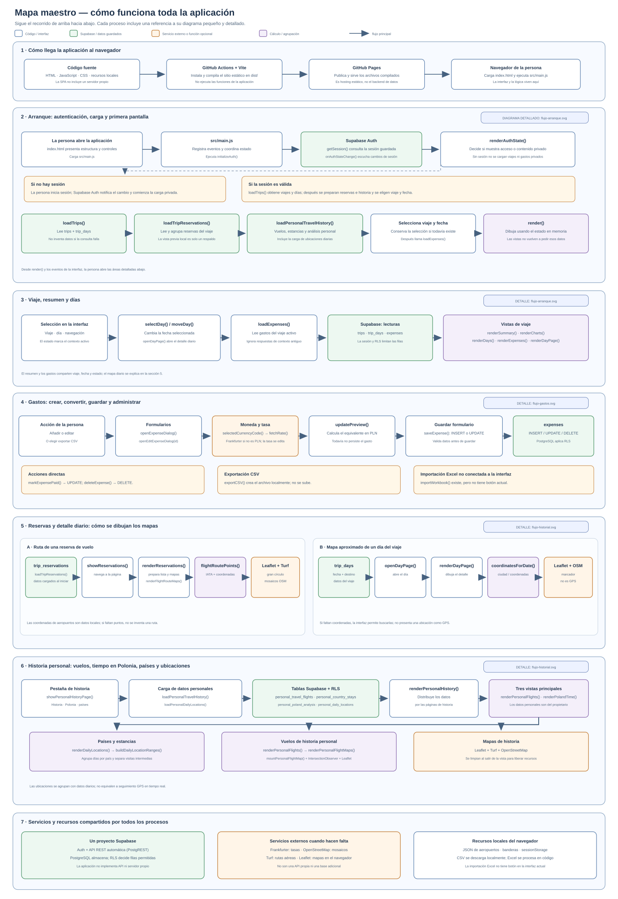
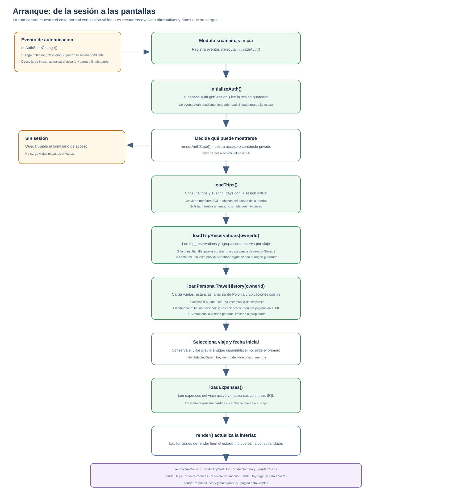
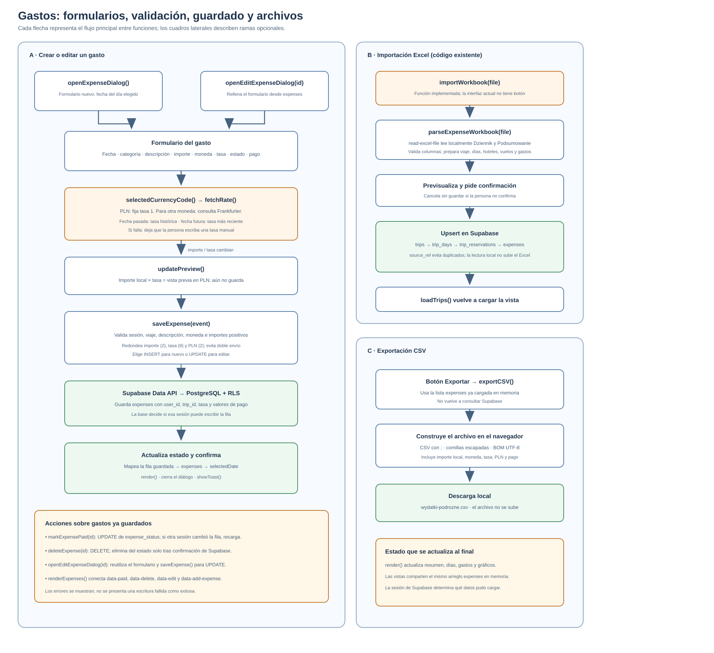
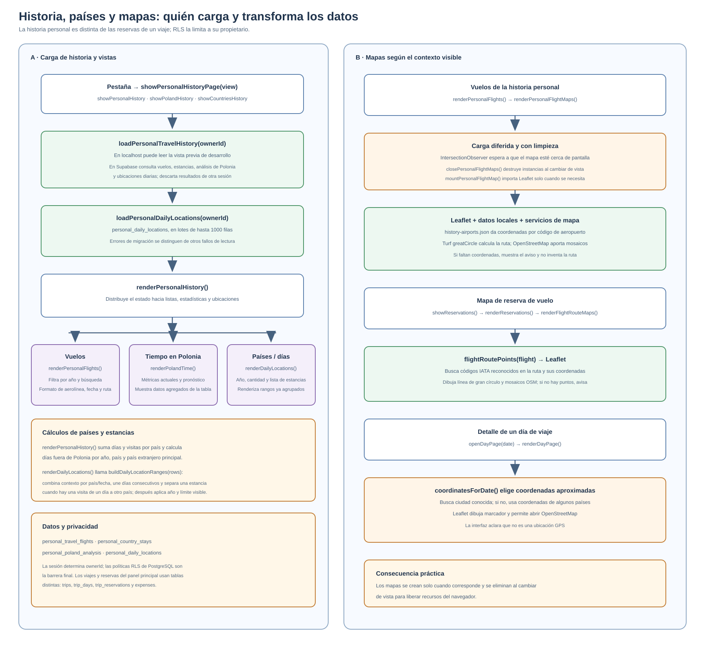
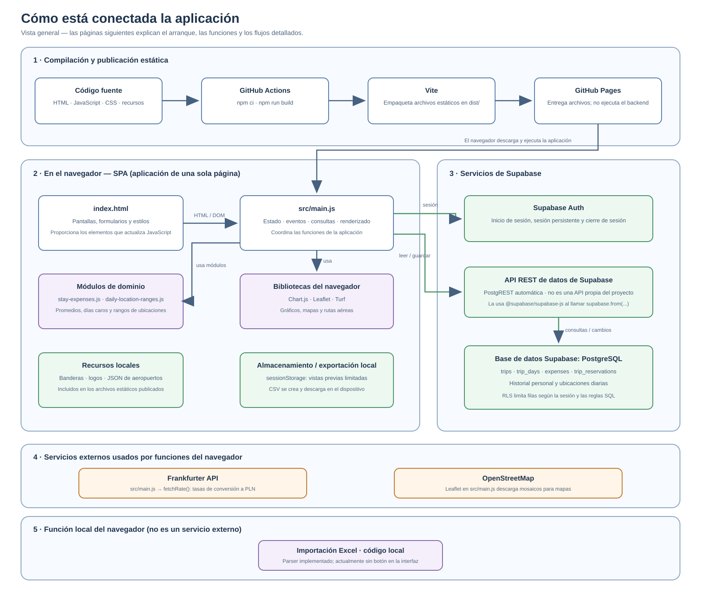
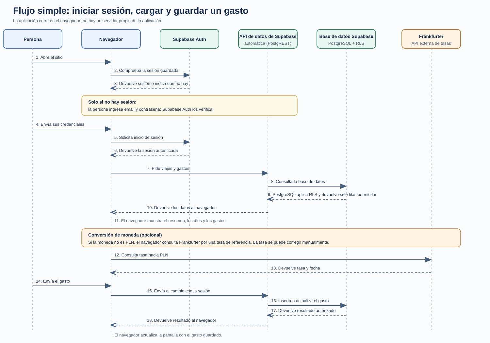
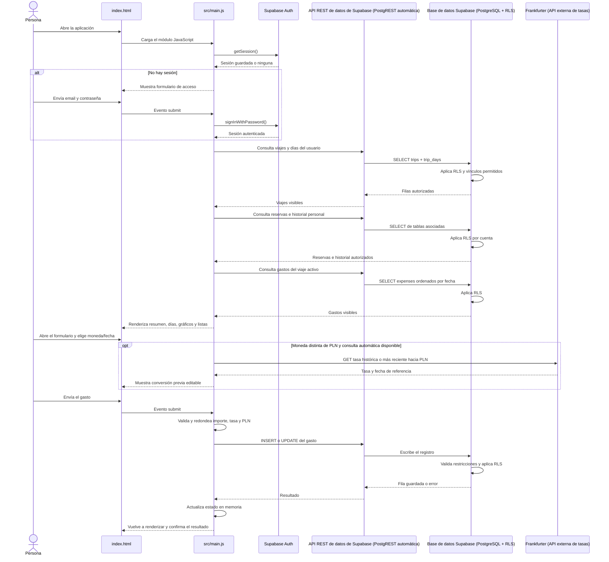

# Arquitectura y funcionamiento del código

Esta guía describe el comportamiento actual del repositorio. La aplicación es una SPA de JavaScript nativo: no tiene un servidor propio ni un framework de componentes. El navegador presenta la interfaz y se comunica directamente con Supabase y con algunos servicios externos.

## Guía completa y diagramas de funcionamiento

El [catálogo de funciones y conexiones](./guia-de-funciones.md) explica qué hace cada función principal, cómo se conectan los módulos y qué datos y servicios participan. Para explorar y editar los diagramas en pestañas separadas, abre [`funcionamiento.drawio`](./funcionamiento.drawio) con diagrams.net / Draw.io.

### Mapa maestro: recorrido completo

Este diagrama conecta publicación, acceso, carga de datos, pantallas, gastos, reservas, mapas e historia personal. Cada sección indica cuál diagrama pequeño consultar para ver el proceso con más detalle.



Referencias a los procesos detallados: [arranque y renderizado](./flujo-arranque.svg), [gastos y archivos](./flujo-gastos.svg) y [historia, reservas y mapas](./flujo-historial.svg).

### Arranque y renderizado



### Gastos y archivos



### Historia personal y mapas



## Diagrama de arquitectura



GitHub Pages sirve el resultado estático de Vite; no ejecuta la lógica de la aplicación en un servidor. Las consultas de datos salen del navegador hacia Supabase. La clave `publishable` identifica al cliente, pero la autorización de filas depende de la sesión y de las políticas RLS de PostgreSQL.

### Qué significan Supabase, PostgreSQL, la API de datos y Frankfurter

- **Supabase** es el servicio que usa la aplicación para autenticación y datos. En este proyecto no se instaló un servidor de base de datos propio.
- **PostgreSQL** es el motor de base de datos que Supabase administra para el proyecto. No es otra base de datos aparte de Supabase: es la tecnología de base de datos que Supabase ofrece. Las políticas RLS se ejecutan ahí para limitar qué filas puede leer o cambiar cada cuenta.
- **API de datos de Supabase (PostgREST)** es la interfaz REST que Supabase genera y administra automáticamente sobre las tablas. No creaste una API propia ni rutas de servidor en este repositorio. `@supabase/supabase-js` usa esa interfaz cuando el código llama, por ejemplo, `supabase.from('expenses').select(...)`.
- **Frankfurter** es un servicio externo, independiente de Supabase. El navegador consulta su API pública para obtener tasas de referencia hacia PLN cuando se necesita convertir una moneda; la tasa también se puede ingresar o corregir manualmente.

En corto: **Supabase** es el servicio; **PostgreSQL** es la base de datos dentro de ese servicio; la **API de datos** es la puerta REST automática hacia las tablas; **Frankfurter** solo proporciona tasas de cambio.

El diagrama editable está en [`arquitectura.drawio`](./arquitectura.drawio).

## Diagrama de secuencia: acceso, carga y registro de un gasto



Abre el archivo [`secuencia.drawio`](./secuencia.drawio) para editarlo en diagrams.net / Draw.io.

<details>
<summary>Ver secuencia detallada en Mermaid</summary>


</details>

Si la moneda es PLN, la tasa es 1:1 y no se consulta Frankfurter. Si la consulta externa falla, el formulario permite ingresar la tasa manualmente. Las respuestas tardías de Supabase se descartan si cambió la cuenta o el viaje durante la solicitud.

## Cómo se organiza el código

### Entrada y estado de la interfaz

- [`index.html`](../index.html) contiene el HTML de la pantalla de acceso, el resumen, los formularios, los diálogos y las secciones de historial. También contiene el CSS, incluidos los estilos adaptables a pantallas pequeñas. Al final carga `src/main.js`.
- [`src/main.js`](../src/main.js) coordina la aplicación: crea el cliente Supabase con `VITE_SUPABASE_URL` y `VITE_SUPABASE_PUBLISHABLE_KEY`, captura los elementos del DOM, mantiene el estado en memoria, escucha eventos y renderiza las vistas.
- El estado principal incluye la cuenta activa, los viajes, el viaje seleccionado, los gastos cargados, la fecha seleccionada y el historial personal. Al cerrar sesión, se limpian los datos privados de la memoria visible.

### Inicio y lectura de datos

1. `initializeAuth()` recupera la sesión de Supabase y coordina esa lectura con `onAuthStateChange`.
2. Sin sesión, se mantiene visible el formulario de acceso. El envío del formulario llama a `signInWithPassword()`.
3. Con sesión, `loadTrips()` consulta los viajes y los días. Después carga las reservas y el historial personal, selecciona un viaje y llama a `loadExpenses()`.
4. `loadTripReservations()` organiza hoteles y vuelos por viaje. Puede usar una vista previa de reservas guardada localmente en la sesión.
5. `loadPersonalTravelHistory()` consulta vuelos, estancias, análisis de tiempo en Polonia y ubicaciones diarias. La carga de ubicaciones se pagina para soportar historiales grandes.
6. `loadExpenses()` consulta los gastos del viaje activo, transforma los nombres de columnas SQL al formato usado por la interfaz y actualiza el indicador de sincronización.
7. Las lecturas pertenecen a la sesión autenticada; RLS sigue siendo el control de acceso definitivo en la base de datos. La aplicación también descarta respuestas tardías asociadas a otra cuenta o viaje.

### Gastos, cálculos y exportación

- `openExpenseDialog()` y `openEditExpenseDialog()` preparan el formulario para crear o modificar un registro.
- `fetchRate()` consulta Frankfurter para una fecha histórica o la tasa más reciente cuando la fecha es futura. La tasa puede editarse manualmente; `updatePreview()` calcula el equivalente en PLN.
- `saveExpense()` valida la descripción, la moneda y los valores positivos; redondea el importe local a dos decimales y la tasa a ocho; luego inserta o actualiza el gasto en Supabase.
- `markExpensePaid()` cambia el estado de pago; `deleteExpense()` elimina el registro solo después de que Supabase confirme la operación.
- `renderSummary()` calcula los totales y `renderCharts()` actualiza los gráficos. El total y los gráficos incluyen todas las categorías; el promedio y el día más caro excluyen `Loty` y `Transport`. `Transport łącznie` suma ambas categorías.
- `exportCSV()` genera y descarga en el navegador un CSV con importe local, moneda, tasa, PLN y datos de pago. No envía el CSV a otro servicio.

### Vistas, mapas e historial

- La navegación cambia entre resumen, reservas, historial de vuelos, países visitados y análisis de tiempo en Polonia. La página de detalle diario se abre desde un día del itinerario.
- `renderDays()`, `renderExpenses()`, `renderReservations()` y `renderPersonalHistory()` generan las listas a partir del estado actual; `renderSummary()` y `renderCharts()` generan los indicadores y gráficos.
- `src/daily-location-ranges.js` agrupa registros consecutivos por país, combina contextos repetidos y separa una estancia cuando hay una visita de un día a otro país. Conserva países distintos registrados en una misma fecha.
- `src/stay-expenses.js` calcula promedio y día más costoso sin contar vuelos ni transporte.
- Leaflet se importa dinámicamente cuando se necesita un mapa. Las rutas pueden dibujarse usando `@turf/great-circle`; los mosaicos del mapa vienen de OpenStreetMap. Las coordenadas de aeropuertos y sus países están en los JSON locales.
- `src/country-flag-assets.js` crea, durante la compilación, el mapa entre códigos de país y archivos SVG locales.

### Importación y archivos de datos

- `src/excel-import.js` conserva el parser técnico para las hojas `Dziennik` y `Podsumowanie`; puede producir datos de viaje, gastos y reservas.
- `importWorkbook()` en `src/main.js` conserva la rutina de persistencia del importador. Sin embargo, la interfaz actual no ofrece selector ni control para importar Excel; no se debe asumir que la importación está disponible para el usuario.
- `src/history-airports.json` contiene coordenadas por código de aeropuerto y `src/history-airport-countries.json` relaciona códigos con países. Son datos estáticos, no comentarios ni configuración de secretos.
- Las banderas y logos de `src/assets/` se empaquetan como recursos estáticos locales.

### Base de datos y privacidad

- [`supabase/schema.sql`](../supabase/schema.sql) define el esquema inicial de viajes, días, reservas y gastos, sus índices y políticas RLS.
- Las migraciones de [`supabase/migrations/`](../supabase/migrations/) amplían una base ya existente: importación Excel, múltiples viajes, reservas, acceso compartido explícito, historial personal y ubicaciones diarias.
- `account_links` permite que dos cuentas vinculadas explícitamente compartan ciertos viajes y sus gastos/reservas. Las políticas llaman a `can_access_account()` para comprobar ese vínculo. El historial personal de vuelos, estancias y ubicaciones permanece restringido a su propietario.
- Las políticas de PostgreSQL restringen consultas y escrituras aunque un usuario manipule el navegador. No se debe colocar una clave `secret` o `service_role` en el cliente.

## Archivos de configuración y verificación

| Archivo | Función |
| --- | --- |
| [`package.json`](../package.json) | Dependencias y comandos npm de desarrollo, build y preview. |
| [`vite.config.js`](../vite.config.js) | Configura la ruta base que usa GitHub Pages. |
| [`.github/workflows/deploy.yml`](../.github/workflows/deploy.yml) | Construye `dist` al actualizar `main` o al ejecutar el workflow manualmente y publica el artefacto en GitHub Pages. |
| [`src/daily-location-ranges.test.js`](../src/daily-location-ranges.test.js) | Pruebas de agrupación de ubicaciones y visitas de un día. |
| [`src/stay-expenses.test.js`](../src/stay-expenses.test.js) | Pruebas de los cálculos que excluyen transporte. |
| [`spec-country-daily-history.md`](../spec-country-daily-history.md) y [`spec-supabase-cloud-sync.md`](../spec-supabase-cloud-sync.md) | Especificaciones de funcionalidad y decisiones históricas; no se ejecutan en la aplicación. |

Comandos principales:

```powershell
npm run dev
npm run build
node --test src\daily-location-ranges.test.js src\stay-expenses.test.js
```
